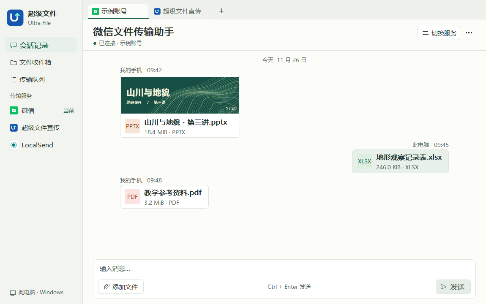

# 超级文件 · Ultra File

[网页版 · Web app](https://watertube-bilibili.github.io/wxfilehelper-desktop/) · [中文](#中文) · [English](#english) · [Windows 下载](https://github.com/Watertube-bilibili/wxfilehelper-desktop/releases) · [macOS 仓库](https://github.com/Watertube-bilibili/wxfilehelper-macos) · [免责声明 / Disclaimer](DISCLAIMER.md)



## 中文

2.0 预览版的传输核心使用 Go。Windows 界面采用 Win32，macOS 界面采用 AppKit。软件直接连接微信文件传输服务，通过手机微信扫码授权。本项目独立维护，与腾讯和微信无隶属关系。

Windows 使用会话时间线。左栏可查看会话记录、会话中的文件和待发送队列。选中附件可另存为，选中带下载信息且在 25 MiB 以内的 PPTX 可点「预览封面」。程序按需下载临时副本，读取文档内嵌的缩略图后删除副本。没有封面的演示文稿保留普通文件卡片。

每个标签右上角可「切换服务」。最多四个标签可以同时运行。更多菜单里的「当前服务设为启动默认」会保存到当前 Windows 用户。

| 服务 | 收发方法 |
| --- | --- |
| 微信文件传输助手 | 用微信扫码，在当前标签内收发。 |
| 超级文件直传 | 手机和电脑连接同一局域网。在电脑上启用直传，再用安卓客户端扫码。手机可以选择文件发送。反向传输时先在电脑选择文件，再在手机点「接收电脑上的文件」并选择保存位置。 |
| LocalSend | 在标签内使用官方 LocalSend 1.19.0 的「接收、发送、设置」。Windows 安装版默认勾选原版组件，可离线安装。便携版可按需获取组件，也可以选择已解压的官方版本。 |

直传以 4 MiB 分块，通过两路连接交错传输，失败的块最多重试两次，完成后校验整份文件的 SHA-256。单文件上限 8 GiB。配对码含当前会话的密钥，接收者可以下载当前共享文件并上传文件。电脑收件在下载目录的 Ultra File 子目录。关闭连接所在的标签或退出程序会终止配对。

### 远程直传与网页版

在「超级文件直传」选择「远程 UDP」，或打开[网页版](https://watertube-bilibili.github.io/wxfilehelper-desktop/)。接收方生成 12 位配对码，发送方输入配对码并选文件。接收方确认后才开始传输。两个浏览器、两台 Windows 电脑或 Windows 与浏览器均可配对。现有安卓客户端仍可使用「同一 Wi-Fi」扫码直传。

网页由 GitHub Pages 托管。免费 PeerJS 信令服务交换连接信息，Cloudflare STUN 用于发现可用的 UDP 地址。文件经 DTLS 加密，按 16 KiB 分块，通过有序可靠的 WebRTC 数据通道直达对方。两端对整份文件计算 SHA-256。网络封锁 UDP 或 NAT 无法穿透时会提示连接失败。单文件上限 8 GiB；不支持直接写入磁盘的浏览器最多接收 128 MiB。关闭页面会结束当前连接。

微信登录码过期后会在原标签自动刷新。手机已扫码时，可继续在微信里确认。切换标签后，LocalSend 仍可传输。安装版在 LocalSend 标签提供「载入离线组件」。如遇自动解压错误，请点「打开离线 ZIP」（便携版可点「下载官方 ZIP」），解压后点「选择已解压的原版」并选择其中的 `localsend_app.exe`。超级文件会在启动前逐个校验组件文件。[LocalSend 官方发布](https://github.com/localsend/localsend/releases/tag/v1.19.0)

### Windows 下载与使用

| 文件 | 用途 |
| --- | --- |
| `UltraFile-2.0.0-beta.3-Windows-x64-Portable.exe` | 单文件，双击运行 |
| `UltraFile-2.0.0-beta.3-Windows-x64-Setup.exe` | 当前用户安装，提供开始菜单和卸载入口 |
| `SHA256SUMS.txt` | 核对两个 EXE 的 SHA-256 |

- 兼容目标为 **Windows 10 1507（内部版本 10240）及以上的 x64 系统**。两个包都无需另装 Python、Qt 或 WebView2。
- 用手机微信扫一扫，确认授权，再在当前标签发送文字或文件。点击 `+` 可添加第二个账号。两个标签各自保留消息和待发送文件。
- 选择、拖入或粘贴文件，核对发送列表后点击「发送」。每批最多 100 个文件，每项 1 字节到 25 MiB。发送失败时未完成的文件仍可重试。
- 手机发送 PPTX、Word 文档、PDF 或其他普通附件后，可在会话中选中文件，点击「另存为」。如果微信只提供文件名，仍然会显示附件。
- 关闭主窗口会收起到 Windows 通知区域，已登录的账号继续收件。后台收到附件时，点击系统通知可回到对应账号。要结束会话，右键托盘图标，选择「退出程序」。
- 安装时可选择「创建桌面快捷方式」和「登录 Windows 时在后台启动」。自启动默认关闭。重启程序后需重新扫码。
- 程序在启动时和运行期间每 6 小时检查 GitHub 更新，自动检查失败后 15 分钟重试。发现新版时，窗口内会出现发布页入口。

### 从源码构建

需要 x64 Go 1.26 和 Inno Setup 6。项目源码位于 `native/`。首次构建会下载固定版本的 Go 资源编译工具。

```powershell
cd native
go test ./internal/...
cd ..
.\native\packaging\windows\build.ps1 -Verify
```

生成的 EXE 位于 `native/dist/windows/`。若工具位于自定义目录，可传入 `-Go` 或 `-Iscc`。macOS 独立发布，两种架构的构建步骤在 [macOS 仓库](https://github.com/Watertube-bilibili/wxfilehelper-macos)。旧 0.2 的 Python/Qt 源码见 [历史标签](https://github.com/Watertube-bilibili/wxfilehelper-desktop/tree/v0.2.0-beta.3)。

构建含离线 LocalSend 的安装版时，将 `-LocalSendArchive` 指向官方 1.19.0 Windows x64 ZIP。脚本会先核对 ZIP 的 SHA-256。

### 隐私与许可

登录票据、消息和发送队列仅在进程内存中保留。收到的文件由用户选择保存位置。微信服务处理扫码和文件传输，GitHub 接收更新检查请求。每个账号须自行扫码授权。微信服务接口、账户条件和网络状态可能影响可用性。[双语免责声明](DISCLAIMER.md)

采用 **AGPL-3.0-only**。 [许可证](LICENSE) · [第三方声明](THIRD_PARTY_NOTICES.md)

### 安卓构建 / Android build

Android 7.0+。使用 JDK 17、Android SDK Platform 35、Build Tools 35、ZXing core 3.5.3 和自己的签名密钥。Set ULTRAFILE_STORE_PASSWORD locally and run android/build.ps1 with -Jdk, -BuildTools, -AndroidJar, -Zxing, -KeyStore and -Alias. The signed APK is written to android/dist/.

## English

The 2.0 preview uses a shared Go transfer core with Win32 on Windows and AppKit on macOS. It connects directly to WeChat File Transfer, with sign-in approved by scanning a QR code in WeChat. This independently maintained project is unaffiliated with Tencent and WeChat.

On Windows, the sidebar opens the conversation, its files, or its send queue. Select an attachment to save it. For a downloadable PPTX with a known size of up to 25 MiB, choose **Preview cover** to read its embedded thumbnail. Ultra File fetches a temporary copy on demand and removes it after inspection. Presentations without a thumbnail keep an ordinary file card.

Use **Services** at the top of a tab. Run up to four tabs concurrently and use the menu to save a startup service for the current Windows user.

| Service | How to transfer |
| --- | --- |
| WeChat File Transfer | Scan with WeChat and use the tab's conversation. |
| Ultra File LAN | Join the same LAN, enable the desktop listener and scan its QR in the Android companion. Pick a file on Android to upload. To download, first share a file on the PC, then choose Receive and a destination on the phone. |
| LocalSend | Use the official LocalSend 1.19.0 Receive, Send and Settings screens inside the tab. Setup includes the optional offline component, selected by default. Portable users can fetch it on demand or select an extracted official copy. |

Two lanes carry alternating 4 MiB chunks, retry failures up to twice, and verify the final SHA-256. Each file can be up to 8 GiB. Pairing credentials allow the holder to upload and download the shared file. Windows saves incoming LAN files under Downloads/Ultra File. Closing the associated tab or quitting ends pairing.

### Remote and browser transfers

Choose **Remote UDP** in Ultra File LAN or open the [web app](https://watertube-bilibili.github.io/wxfilehelper-desktop/). The receiver creates a 12-character code. The sender enters it and selects a file. Transfer starts after acceptance. Two browsers, two Windows PCs, or one of each can pair. The existing Android companion pairs using **Same Wi-Fi**.

GitHub Pages hosts the web UI. Free PeerJS signaling exchanges connection information and Cloudflare STUN discovers UDP addresses. Endpoints send ordered, reliable 16 KiB chunks over a DTLS-encrypted WebRTC data channel and verify the complete SHA-256. Blocked UDP or incompatible NAT can prevent a direct connection. The maximum file size is 8 GiB. Browsers without direct disk saving can receive up to 128 MiB. Closing the page ends the connection.

WeChat refreshes expired QR codes in the same tab. After scanning, complete approval on your phone. LocalSend keeps transferring when you switch tabs. Choose **Load offline component** after installation. If automatic extraction fails, choose **Open offline ZIP** (or **Download official ZIP** in the portable edition), extract the ZIP, then use **Choose extracted app** to select its `localsend_app.exe`. Ultra File verifies the component files before launch. [Official LocalSend release](https://github.com/localsend/localsend/releases/tag/v1.19.0)

### Download and use on Windows

| Asset | Use |
| --- | --- |
| `UltraFile-2.0.0-beta.3-Windows-x64-Portable.exe` | Single executable. Double-click to launch. |
| `UltraFile-2.0.0-beta.3-Windows-x64-Setup.exe` | Per-user installation with a Start menu and uninstaller. |
| `SHA256SUMS.txt` | SHA-256 checksums for both executables. |

- Targets **x64 Windows 10 version 1507 (build 10240) or later**. Both packages run without a Python, Qt, or WebView2 installation.
- Scan with WeChat and approve sign-in. Select `+` to add a second independently authorized account. Each tab maintains its own messages and outgoing file queue.
- Pick, drag, or paste files and review the queue before sending. A batch supports up to 100 files of 1 byte to 25 MiB each. Files that fail or remain unsent stay in the queue for retry.
- Select a presentation, document, PDF or other attachment from your phone and choose **Save as**. A file still appears by name if WeChat omits the download details.
- Closing the window keeps signed-in accounts receiving files in the Windows notification area. Click a background file notification to open the corresponding account. Right-click the tray icon and choose **Quit Ultra File** to end the session.
- Setup offers a desktop shortcut and optional launch in the background at Windows sign-in. Automatic startup is off by default. Scan again after restarting the app.
- The app checks GitHub at startup and every six hours while running. Failed scheduled checks retry after 15 minutes. An available update appears in the window with a link to its release.

### Build from source

To include LocalSend for offline installation, pass its official 1.19.0 Windows x64 ZIP to `-LocalSendArchive`. The script checks the archive's SHA-256.

Use x64 Go 1.26 and Inno Setup 6. Run `go test ./internal/...` from `native/`, then run `native/packaging/windows/build.ps1 -Verify` from the repository root. The first build downloads a pinned Go resource compiler. Outputs are under `native/dist/windows/`. This repository distributes the Windows application. The [separate macOS repository](https://github.com/Watertube-bilibili/wxfilehelper-macos) ships both Mac architectures. The earlier Python/Qt implementation is available at its [0.2 tag](https://github.com/Watertube-bilibili/wxfilehelper-desktop/tree/v0.2.0-beta.3).

### Privacy and licensing

Session credentials, messages, and queued file paths stay in memory. Received files are saved where you choose. WeChat processes sign-in and transfer requests. GitHub receives update checks. The service interface, account eligibility, and network conditions can affect availability. [Bilingual disclaimer](DISCLAIMER.md)

Licensed under **AGPL-3.0-only**. [License](LICENSE) · [Third-party notices](THIRD_PARTY_NOTICES.md)
